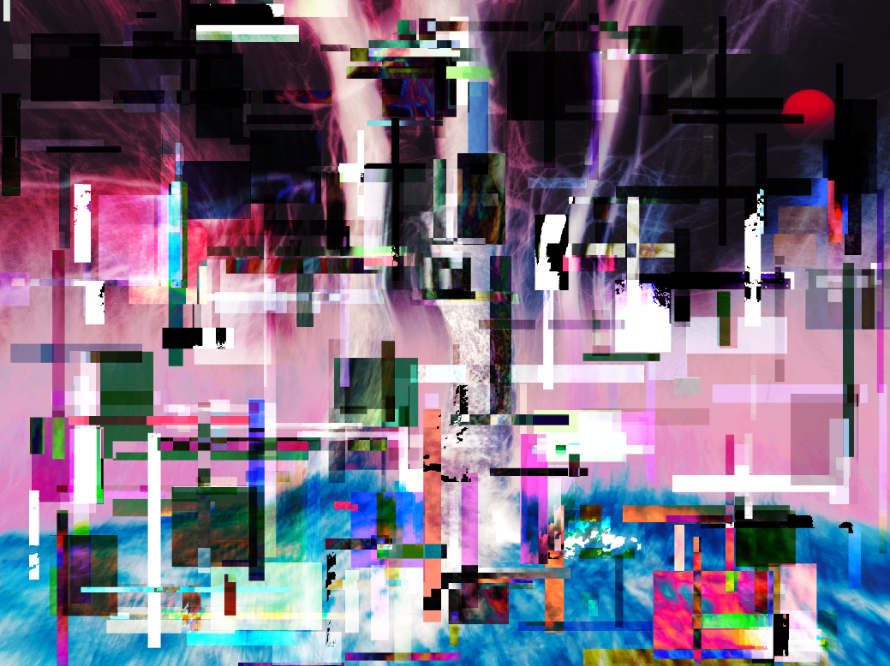

# E1. Ricombinare una fotografia

Lavoro pubblicato su: https://github.com/ilatesss/aa2627-tnmi-es/tree/main/es1

`preview.png` va creata quando il lavoro è pronto: serve all'anteprima nella pagina delle revisioni del corso.
